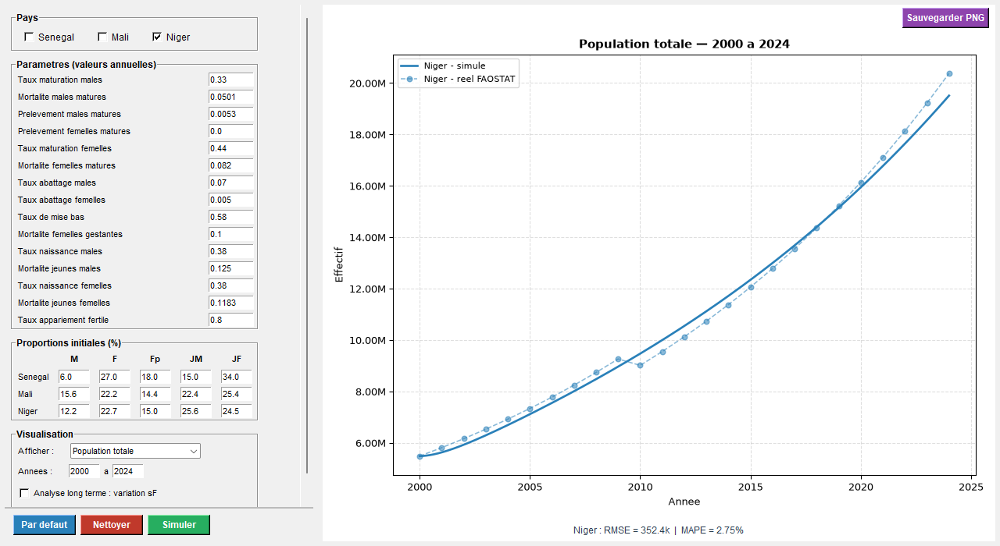
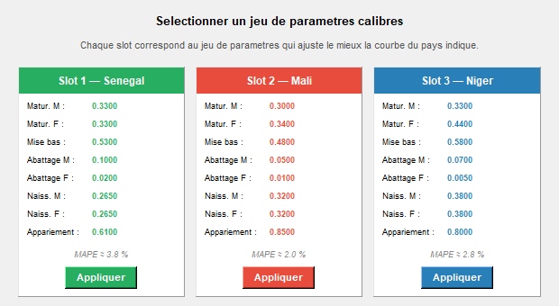
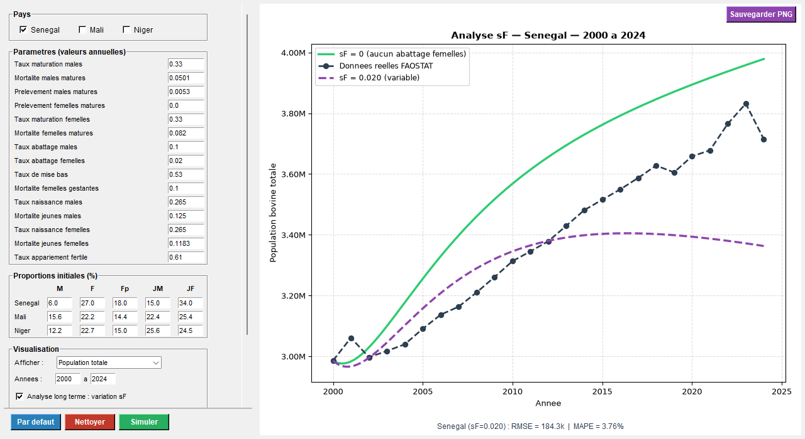
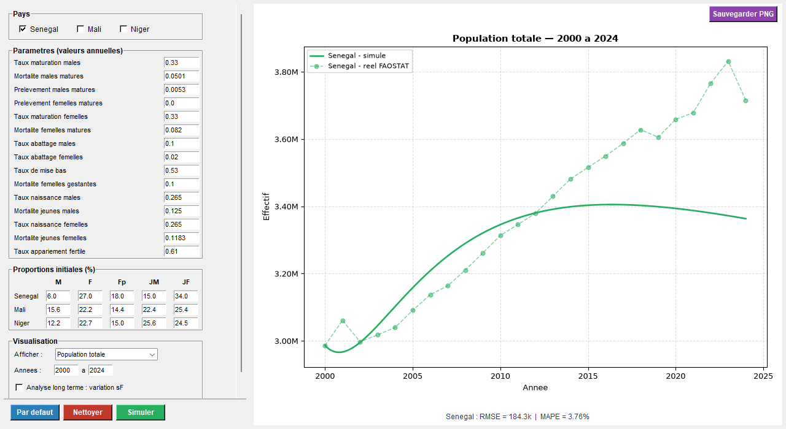
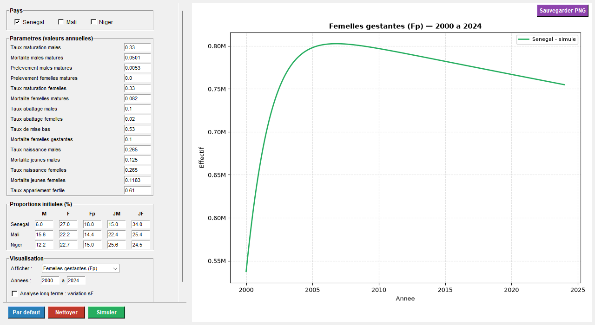

# Cattle herd simulator: an ODE model solved with Runge-Kutta 4 (Python desktop app)

A desktop application that simulates how cattle herds evolve in Senegal, Mali and Niger (2000–2024). It solves a system of differential equations with a hand-coded 4th-order Runge-Kutta method and compares the simulation with FAOSTAT data.

> Academic project for the *Scientific Computing 1* course at ENSAE Pierre Ndiaye, Dakar (ISE1, 2025–2026, supervisor: Dr Oumar DIOP).
> **Team:** Apollos Sergio Comlan BAGBONON · Hamadou DICKO · Sènou Michel-Marie Trésor TEVOEDJRE · Eugène Crespo YEMELI SAAH



## What the app does

- **Choose the countries** (Senegal, Mali, Niger) and edit the model parameters: maturation, mortality, offtake, birth and mating rates, and the initial structure of the herd.
- **Simulate** the herd with Runge-Kutta 4 (adjustable time step) and overlay the real FAOSTAT stocks, with fit metrics (RMSE, MAPE).
- **Display** the total herd or each compartment: adult males, non-pregnant females, pregnant females, young males, young females.
- **Load calibrated parameter sets**, one per country.
- **Long-term analysis**: a slider changes the female slaughter rate and shows its effect on the herd.
- **Export** the chart as a PNG.

## The model in brief

Five compartments (M, F, Fp, JM, JF) linked by births, maturation, deaths and offtake. Mating follows a saturating function `a·F·M/(M + k)`. The system `du/dt = f(t, u)` is solved step by step with the classic RK4 scheme, coded from scratch in NumPy.

## Run

```bash
pip install -r requirements.txt
python app.py            # on Windows you can also double-click LANCER_APPLICATION.bat
```

`donnees_FAOSTAT.xlsx` holds the FAOSTAT cattle stocks (FAO, CC BY 4.0) used for the comparison.

## Screenshots

| Calibrated parameter sets | Long-term analysis (female slaughter rate) |
|---|---|
|  |  |
| **Senegal** | **One compartment (pregnant females)** |
|  |  |

Stack: Python 3 · NumPy · Matplotlib (embedded in Tkinter) · Tkinter · openpyxl
